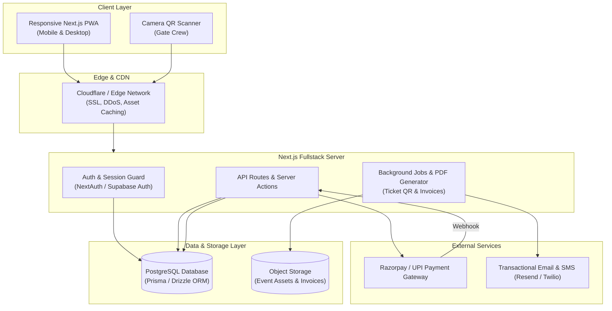

# Concrete Fair 2026 — Target State Summary (PRD Blueprint)
**Document Version:** 1.0  
**Source Document:** [`docs/PRD.md`](file:///c:/Hacks/CT-Fair/docs/PRD.md) (74 Sections, 2,186 lines)  
**Target Event Dates:** 30 November – 01 December 2026  
**Hosting Institution:** Department of Civil Engineering, RV College of Engineering, Bengaluru  

---

## 1. Product Vision & Core Philosophy

> **"Turn Concrete Fair from a campus event into an integrated, end-to-end digital conclave experience."**

The platform is designed to take every attendee through a seamless digital funnel:
$$\text{DISCOVER} \longrightarrow \text{UNDERSTAND} \longrightarrow \text{EXPLORE} \longrightarrow \text{CHOOSE} \longrightarrow \text{REGISTER} \longrightarrow \text{PAY} \longrightarrow \text{RECEIVE PASS} \longrightarrow \text{ATTEND} \longrightarrow \text{CHECK IN}$$

### Design Philosophy: *Premium Through Restraint*
- **Aesthetic Identity:** A premium architectural journal × civil-engineering symposium × modern event platform.
- **Visual Tenets:** Stone white, cement grey, slate, and measured gold accents. Technical metadata, structural crop marks, and blueprint grids.
- **Anti-Patterns:** Avoid generic college fest collages, flashy multicolor gradients, AI slop, SaaS boilerplate, or cluttered ticket-booking clones.

---

## 2. Target Platforms & Experiences

The target platform comprises three interconnected systems governed by strict Role-Based Access Control (RBAC):

```
┌─────────────────────────────────────────────────────────────────────────────┐
│                             CONCRETE FAIR 2026                              │
└───────────────────────┬─────────────────────────────┬───────────────────────┘
                        │                             │
        ┌───────────────┴──────────────┐      ┌───────┴───────────────────────┐
        ▼                              ▼      ▼                               ▼
 ┌──────────────┐              ┌──────────────┐                      ┌─────────────────┐
 │ Public Story │              │ Delegate &   │                      │ Organizer CMS & │
 │ & Discovery  │              │ Participant  │                      │ Gate Operations │
 │ Portal       │              │ Platform     │                      │ (Admin / Crew)  │
 └──────────────┘              └──────────────┘                      └─────────────────┘
```

### 2.1 Public Experience (Editorial & Discovery)
1. **Conclave Storytelling:** Presenting the overarching narrative:
   - **Tradition:** Ancient monuments, Vedic stone joinery, Roman pozzolanic mortars, and 60+ years of RVCE Civil Engineering legacy (Est. 1963).
   - **Transformation:** NABL-accredited 2,000 kN testing bay, servo shake-tables, and computational LOD-400 BIM sprint labs.
   - **Tomorrow:** Carbon-negative geopolymers, LC3 calcined clays, bacterial self-healing bio-concrete, and 3D concrete printing.
2. **Interactive 3D Architectural Monument:** WebGL architectural study allowing visitors to inspect dry-friction cyclopean stone joints and seismic-resistant Vedic Shikharas.
3. **Curated Event Catalogue:** Full exploration of competitions, testing bay challenges, keynotes, and cultural quizzes with detailed rules, team size constraints, and fee schedules.

---

### 2.2 Participant & Delegate Platform
1. **Unified Authentication & Profile:**
   - Passwordless magic link or OTP authentication for external delegates and RVCE students.
   - Profile capture: Full Name, Institutional Affiliation, Student USN / Roll No., Department, and Phone Number.
2. **Multi-Registration & Cart Engine:**
   - Multi-event selection: Registering for a competition (e.g. *Canoe-X*), a workshop (e.g. *Bio-Concrete*), and keynote lectures in a single transaction.
   - Dynamic team roster builder: Team Captain enters teammates' names, colleges, and contact emails with real-time capacity checks.
3. **Secure Payment & Verification:**
   - Integrated Payment Gateway (Razorpay / Cashfree) supporting UPI, Cards, NetBanking.
   - Automatic GST invoice generation, waiver validation (for VIPs/faculty), and idempotent webhook reconciliation.
4. **Digital Ticket & Dynamic QR Pass:**
   - Cryptographically signed QR tokens (`HMAC-SHA256`) to prevent pass forgery and screenshot sharing.
   - Offline Apple Wallet / Google Wallet pass dockets and downloadable PDF receipts.
   - Event-specific laboratory safety checklist & PPE equipment badges (e.g., steel-toed boots required for Bay A).
5. **Live Delegate Dashboard:**
   - Chronological personalized event itinerary.
   - Live campus broadcast notifications and reporting time alerts.

---

### 2.3 Organizer & Gate Operations Platform
1. **Real-time Capacity & Ticket Quota Engine:**
   - Hard capacity enforcement with automated status transitions (`OPEN` $\to$ `FILLING FAST` $\to$ `SOLD OUT` $\to$ `CLOSED`).
   - Manual quota overrides and reserve seating allocations for institutional guests.
2. **High-Speed Gate Check-in System:**
   - WebRTC / native camera-based QR barcode scanner operable on mobile phones or dedicated gate tablets.
   - **Sub-second latency verification (<500ms)** against the live database.
   - Automatic duplicate entry prevention with loud visual/auditory warnings.
   - Manual lookup fallback by USN, phone number, or ticket code.
3. **Participant & Financial Ledger:**
   - Comprehensive reconciliation matrix between registrations, Razorpay settlement IDs, refunds, and waivers.
   - Filterable exports (CSV / XLSX) for institutional audits and attendance certificates.
4. **Broadcast & Announcement Engine:**
   - Multi-channel notification dispatch (In-app, SMS, Email) segmented by event, delegate category, or volunteer crew.
5. **Volunteer & Crew Coordination:**
   - Shift scheduling across 14 testing bays.
   - Crew attendance check-in and task distribution.

---

## 3. Production Technical Architecture

According to the PRD (Sections 59–66), the target production architecture transitions the application from a static frontend into a robust full-stack platform:



---

## 4. Target Core Database Entities (PRD §64)

The PRD mandates a relational data model with the following core entities:

1. **User / Profile:**
   - `id`, `name`, `email`, `phone`, `college`, `usn`, `role` (`DELEGATE`, `VOLUNTEER`, `COORDINATOR`, `ADMIN`), `createdAt`.
2. **Event:**
   - `id`, `code` (`CF-01` to `CF-11`), `name`, `category`, `day`, `startTime`, `endTime`, `venue`, `fee`, `capacity`, `minTeamSize`, `maxTeamSize`, `status` (`DRAFT`, `PUBLISHED`, `SOLD_OUT`, `CLOSED`), `coordinatorId`.
3. **Registration:**
   - `id`, `eventId`, `userId`, `regType` (`INDIVIDUAL`, `TEAM`, `FACULTY`), `teamName`, `status` (`INITIATED`, `PENDING_PAYMENT`, `CONFIRMED`, `CANCELLED`), `createdAt`.
4. **TeamMember:**
   - `id`, `registrationId`, `name`, `email`, `phone`, `college`, `usn`.
5. **Payment:**
   - `id`, `registrationId`, `gateway` (`RAZORPAY`), `gatewayOrderId`, `gatewayPaymentId`, `amount`, `currency` (`INR`), `status` (`INITIATED`, `CAPTURED`, `FAILED`, `REFUNDED`), `verifiedAt`.
6. **Ticket:**
   - `id`, `registrationId`, `ticketCode` (e.g. `CF26-CX-8941`), `signedToken` (`HMAC`), `qrUrl`, `pdfUrl`, `status` (`ACTIVE`, `REVOKED`).
7. **CheckIn:**
   - `id`, `ticketId`, `eventId`, `scannedByUserId`, `scannedAt`, `gateId`, `isDuplicate`.
8. **Announcement:**
   - `id`, `title`, `body`, `targetAudience`, `eventId`, `publishedAt`, `authorId`.

---

## 5. State Machine Requirements (PRD §65–66)

### Registration State Machine
```
[INITIATED] ──(Pay Button Clicked)──► [PENDING_PAYMENT]
     │                                        │
     │ (Free event or Waiver)                 ├──(Payment Webhook Success)──► [CONFIRMED]
     ▼                                        │                                    │
[CONFIRMED] ◄─────────────────────────────────┘                                    ├──(Gate Scan)──► [CHECKED_IN]
     │                                                                             │
     └──(Capacity Expired / User Drop)──► [CANCELLED]                              └──(Refund Req)──► [REFUNDED]
```

### Event State Machine
```
[DRAFT] ──► [PUBLISHED] ──► [REGISTRATION_OPEN]
                                   │
                                   ├──(Capacity Reached)──► [SOLD_OUT]
                                   │
                                   ├──(Manual / Time Cutoff)──► [REGISTRATION_CLOSED]
                                   │
                                   ├──(Event Day Active)──► [IN_PROGRESS]
                                   │
                                   └──(Post Event)──► [CONCLUDED]
```

---

## 6. Target MVP Scope vs. Phase 2 (PRD §70–71)

### MVP Scope (Must-Have for Launch)
- [x] Responsive public website with editorial brutalist design.
- [x] Complete event catalogue with filtering and search.
- [ ] Working PostgreSQL database with migrations.
- [ ] Functional delegate authentication (Email / OTP).
- [ ] Real Razorpay payment integration with automated ticket issuance.
- [ ] Digital ticket pass with camera-based QR code verification at gate desks.
- [ ] Admin ledger with registration CSV export and live check-in monitoring.
- [ ] PDF ticket and invoice download.

### Phase 2 (Enhancements)
- [ ] Bulk college contingent registration (single payment for 20+ students).
- [ ] Automated SMS / WhatsApp ticket delivery.
- [ ] Live leaderboard for competitive bays (*Canoe-X*, *UTM Cube Strength*).
- [ ] Automated issuance of digitally verifiable participation certificates with cryptographic seals.
- [ ] Multi-turnstile RFID hardware badge sync.

---

## 7. Gap Analysis: Current vs. Target

| Capability | Current State | Target State | Gap / Action Required |
|---|---|---|---|
| **Hosting & Rendering** | Static HTML export (`out/`) | Hybrid SSR / Dynamic API routes | Switch `next.config.mjs` from `'export'` to standalone/server mode |
| **Data Persistence** | Static arrays in `lib/data.ts` | PostgreSQL with Prisma / Drizzle | Setup database schema, connection pool, and migrations |
| **Authentication** | Mocked user object | NextAuth.js / Supabase Auth | Implement login, session tokens, and middleware route guards |
| **Checkout & Payments** | Form submit triggers simulated success | Live Razorpay / Cashfree Gateway | Connect payment orders API, checkout popup, and webhook signature verification |
| **Ticketing & Passes** | Static SVG QR generator | Cryptographically signed HMAC QR tokens + PDF dockets | Build ticket issuance service with printable PDF layout |
| **Gate Check-in** | Simulated timeout on button click | WebRTC camera QR scanner on mobile | Integrate `html5-qrcode` / `qr-scanner` library with sub-second API verification |
| **Real-time Updates** | Client component state timers | Server-Sent Events (SSE) or WebSockets | Setup live broadcast feed for gate counts and attendee notifications |
